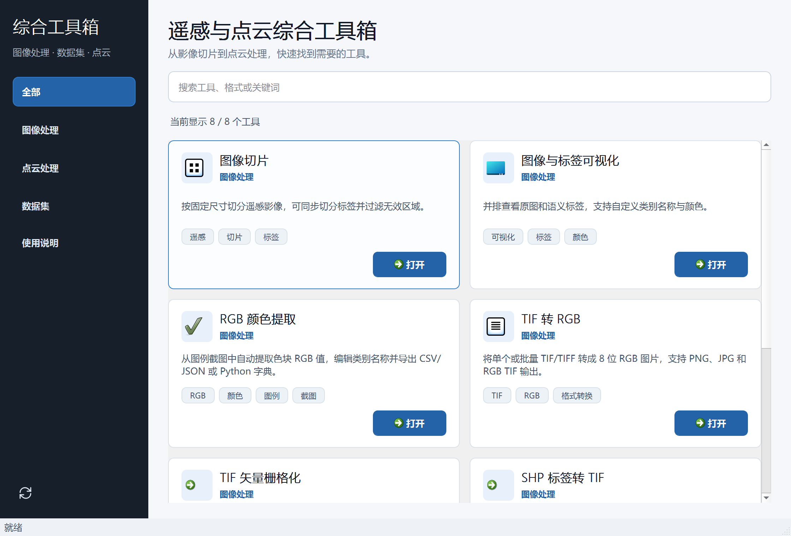

# 遥感与点云综合工具箱

Windows 桌面工具，集中处理遥感影像、矢量标签、VOC 数据集和点云。所有处理在本机进行。



## 下载与安装

在 [GitHub Releases](https://github.com/yaluncoco/RemoteSensingToolbox/releases/latest) 下载：

- `RemoteSensingToolbox-1.2.0-windows-x64-setup.exe`：Windows 10/11 64 位安装包，安装到当前用户目录，无需管理员权限。
- `RemoteSensingToolbox-1.2.0-windows-x64-portable.zip`：便携版，完整解压后运行 `RemoteSensingToolbox.exe`。
- `SHA256SUMS.txt`：下载文件的 SHA-256 校验值。

安装包包含 Python、Qt、GIS 和点云运行库，无需另装 Python/Conda。安装后可从开始菜单打开，在系统“已安装的应用”中卸载。发行包尚未配置代码签名。

主界面左下角提供检查更新图标，默认在启动后和每 6 小时后台检查。有新版时显示红点，点击可查看更新说明并打开下载页面；检查失败可手动重试，不影响本地工具使用。

## 工具

| 工具 | 用途 |
| --- | --- |
| 图像切片 | 分块切片、边缘补齐、同名标签同步切片，保留 8/16 位类别值 |
| 图像与标签可视化 | 大幅 TIFF 缩略预览、自定义类别颜色 |
| RGB 颜色提取 | 图例截图/剪贴板识别，导出 CSV、JSON 和颜色字典 |
| TIF 转 RGB | RGB 波段选择、全局拉伸，输出 PNG/JPG/GeoTIFF |
| TIF 矢量栅格化 | GPKG 生成 ID、RGB 和调色板标签，三份结果保留地理参考 |
| SHP 标签转 TIF | 自定义类别 ID、批量配对、坐标对照、分块栅格化 |
| VOC 数据集制作 | 图像/标签整理、可复现的训练验证划分、16 位整数标签 |
| 点云处理工作台 | 预览、去噪、格式转换、ScanNet、NPY 查看、标签合并、四种下采样 |

## 使用方法

1. 在左侧选择分类，或在右上角输入工具名称、格式、关键词；按 **Ctrl+K** 可直接定位搜索框，也可以用空格组合关键词，例如 `RGB TIF`。
2. 点击卡片上的 **打开**，或双击卡片，进入对应工具。再次打开同一工具会切换到已有窗口。
3. 选择输入文件和输出位置，设置处理参数后运行。工具窗口可独立使用，关闭时会安全处理尚未结束的任务。
4. 左下角的循环箭头用于检查更新。有新版时显示红点，点击后可查看版本说明并前往下载。

主窗口默认 960×600，会根据屏幕可用空间调整；工具卡片随窗口宽度切换为一至三列。调整后的窗口大小和所选分类会在下次启动时恢复。

操作说明统一放在本仓库：[快速开始](Toolbox/quick_start.md) 介绍各工具的操作流程和输出特点，[完整使用手册](遥感点云工具箱_使用与维护手册.md) 提供详细参数。

## 本版改进

- 预测分析的自定义颜色可视化支持 XYZ、XYZ + Label、XYZ + RGB、XYZ + RGB + Label、带法向量及自定义列位置。
- 按数据排列提供标签颜色、原始 RGB 或统一单色；列号从 1 开始，并直接显示坐标、标签和 RGB 对应位置。
- 支持 TXT / XYZ / CSV / PTS 数值文本、空白/逗号/分号分隔、跳过表头；读取选项与前 5 行预览默认折叠。
- 开始前显示样本检查结果，运行时检查完整文件；错误列数、非整数标签、无效坐标和越界颜色会明确提示，标签编号原样保留。
- 保留预测分析原有页面结构和样式；按需显示自定义参数，小窗口使用纵向滚动。
- 修复后台错误消息传递和截图成功判断，支持中文路径 PNG/JPEG 截图，失败时保留原有文件。

具体格式与示例见 [点云可视化指南](docs/POINT-CLOUD-VISUALIZATION.md)。

此前版本的处理与稳定性改进：

- 左下角提供检查更新图标，启动后默认后台检查正式版本；有新版时显示红点，支持重试和前往发布页下载。
- TIF RGB 转换与 GPKG 栅格化改为分块读写；大图百分位拉伸使用全图采样，最小/最大值拉伸使用精确统计。
- 保留地理参考，排除无效像素；RGB TIFF 使用掩膜，避免把有效黑色像素误当作无效区域。
- SHP、切片、VOC 流程保留 16 位类别值，避免类别 ID 大于 255 时被截断。
- 均匀采样覆盖整个文件；最远点采样避免重复选点及大坐标精度问题；体素采样保留原始颜色、标签和全部特征列。
- 支持中文路径下的 PCD/PLY/XYZ 读写，保存失败不会替换已有完整文件。
- NPY 检查使用内存映射和有界预览；批量下采样排除已有输出子目录。
- 后台加载工具和提取色块；安全等待线程结束后关闭窗口；搜索支持多个关键词和 `Ctrl+K`，界面适配小屏幕。
- 提供依赖锁定、回归测试、发行版自检、中文安装包和自动构建流程。

## 开发运行

使用 Windows x64 和 Python 3.10。首次创建独立环境：

```powershell
python -m venv .venv
.\.venv\Scripts\python.exe -m pip install -r requirements-lock.txt
.\.venv\Scripts\python.exe run_toolbox.py
```

`requirements.txt` 列出直接运行依赖，`requirements-build.txt` 增加构建工具；`requirements-lock.txt` 固定本次验证的完整 Windows 构建环境。

## 验证与打包

```powershell
.\.venv\Scripts\python.exe -m unittest discover -s tests -v
.\.venv\Scripts\python.exe run_toolbox.py --self-test --report .build\self-test.json
powershell -ExecutionPolicy Bypass -File scripts\build_windows.ps1 -Python .\.venv\Scripts\python.exe
```

完整打包需要 [Inno Setup 6.5+](https://jrsoftware.org/isinfo.php)。可用 `-Iscc` 指定编译器路径，或用 `-SkipInstaller` 仅生成便携版。构建脚本会运行回归测试、收集许可证、打包程序、验证发行版、编译安装包并生成校验文件。输出位于 `release/`。

安装后的程序也支持自检：

```powershell
& "$env:LOCALAPPDATA\Programs\RemoteSensingToolbox\RemoteSensingToolbox.exe" --self-test --report "$env:TEMP\toolbox-self-test.json"
```

本版安装与界面验证见 [1.2.0 验证记录](docs/VALIDATION-1.2.0.md)，此前的紧凑界面验证见 [1.1.1 验证记录](docs/VALIDATION-1.1.1.md)，此前的更新功能验证见 [1.1.0 验证记录](docs/VALIDATION-1.1.0.md)，历史性能对比见 [1.0.0 验证记录](docs/VALIDATION.md)。

自检包含 8 个工具窗口、TIFF/PNG/JPG 转换、SHP/GPKG 栅格化、中文路径点云读写、标签切片和 VOC。三维实时预览还取决于本机显卡驱动和 OpenGL 支持。

日志位于 `%LOCALAPPDATA%\RemoteSensingToolbox\logs\`。测试、打包中间文件、用户数据和旧发行文件不进入 Git 仓库；GitHub Releases 保存安装包和便携版。

新增工具请参考 [工具注册说明](Toolbox/README.md)。第三方许可证及源码链接见 [THIRD_PARTY_NOTICES.md](THIRD_PARTY_NOTICES.md)。

更新检查使用 `Toolbox/version.py` 中 `UPDATE_REPOSITORY` 指定的 GitHub Releases，版本标签采用 `v1.2.3` 这样的数字版本。客户端只接受正式发布版本，不提示草稿或预发布版本；发行时需同步修改 `APP_VERSION`。更新窗口打开发布页面供用户下载安装，不会自动覆盖正在运行的程序。

更新源必须允许匿名访问。目前配置的 `yaluncoco/RemoteSensingToolbox` 是私有仓库，匿名检查会返回 404，并在手动检查时显示无法读取更新信息。若源码继续保持私有，可另用公开发行仓库保存版本说明和安装包，再调整 `UPDATE_REPOSITORY`；无需将访问令牌放入客户端。
