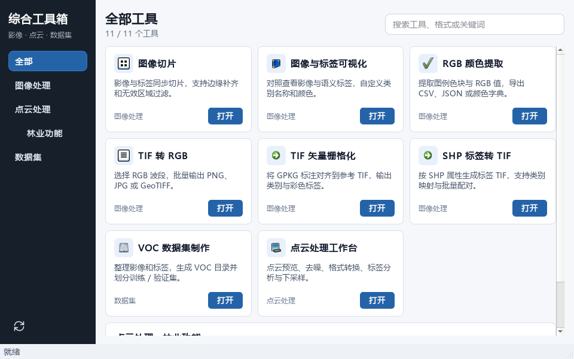
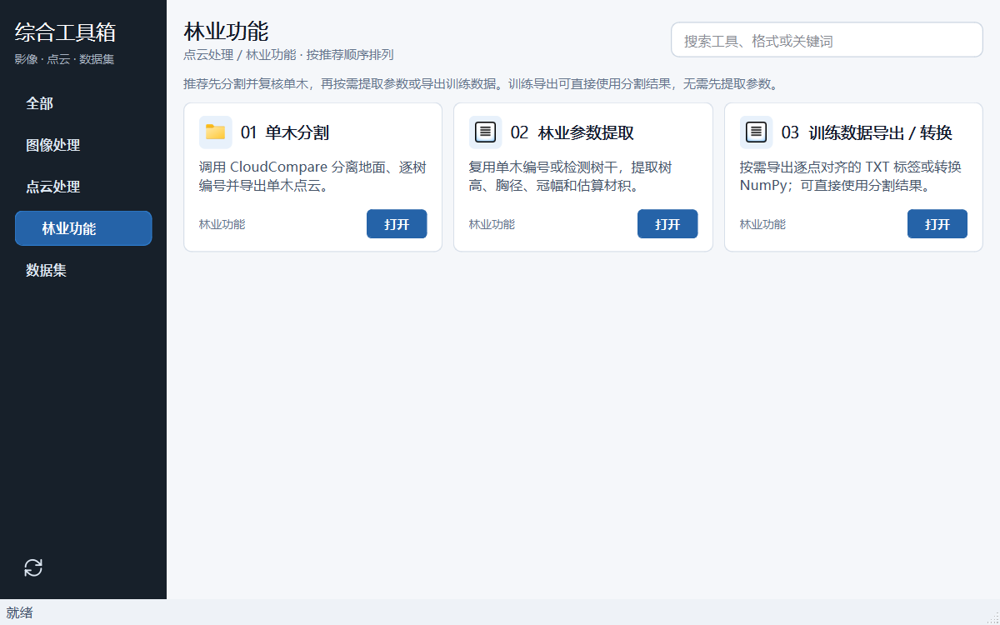

# 遥感与点云综合工具箱

Windows 桌面工具，集中处理遥感影像、矢量标签、VOC 数据集和点云。所有处理在本机进行。



## 下载与安装

在[本项目 GitHub Release 的 Assets](https://github.com/yaluncoco/RemoteSensingToolbox/releases/latest) 中直接下载：

- `RemoteSensingToolbox-1.6.1-windows-x64-setup.exe`：Windows 10/11 64 位安装包，安装到当前用户目录，无需管理员权限。
- `RemoteSensingToolbox-1.6.1-windows-x64-portable.zip`：便携版，完整解压后运行 `RemoteSensingToolbox.exe`。
- `SHA256SUMS.txt`：下载文件的 SHA-256 校验值。

每个正式版本在本项目 Release 的 Assets 中提供安装包、便携包、校验文件和验证报告；v1.5.0 起软件内更新也使用本项目。原独立发行仓库目前不可用，旧版若检查更新失败，请手动下载本版安装包升级一次。

安装包包含 Python、Qt、GIS 和点云运行库，无需另装 Python/Conda。安装后可从开始菜单打开，在系统“已安装的应用”中卸载。发行包尚未配置代码签名。

主界面左下角提供检查更新图标，默认在启动后和每 6 小时后台检查。有新版时显示红点，点击可在软件内下载更新；安装包校验通过后，点击“安装并重启”即可升级。下载支持取消和重试，不影响本地工具使用。

## 工具

| 工具 | 用途 |
| --- | --- |
| 图像切片 | 分块切片、边缘补齐、同名标签同步切片，保留 8/16 位类别值 |
| 图像与标签可视化 | 大幅 TIFF 缩略预览、自定义类别颜色 |
| RGB 颜色提取 | 图例截图/剪贴板识别，导出 CSV、JSON 和颜色字典 |
| TIF 转 RGB | RGB 波段选择、全局拉伸，输出 PNG/JPG/GeoTIFF |
| TIF 矢量栅格化 | GPKG 生成 ID、RGB 和调色板标签，三份结果保留地理参考 |
| SHP 标签转 TIF | 自定义类别 ID、批量配对、坐标对照、分块栅格化 |
| VOC 数据集制作 | 图像/标签整理、可复现的训练验证划分、16 位整数标签 |
| 点云处理工作台 | 预览、去噪、格式转换、ScanNet、NPY 查看、标签合并、四种下采样 |
| 单木分割 | 配置 CloudCompare 路径，CSF + TreeIso 与多切片树干约束校正，减少粘连与重复分株，完整标注和逐树 LAZ 导出 |
| 林业参数提取 | 独立提取树高、胸径、冠幅、冠面积、冠体积和估算材积，输出 CSV/Excel/LAZ 与质量提示 |
| 训练数据导出 / 转换 | 逐点对齐的坐标、语义和实例标签导出，TXT / NumPy 互转，保留原始点索引和忽略掩码 |

v1.4.1 修复了 v1.4.0 安装版在 SVG 绘图阶段失败的问题，已用安装后的程序完成真实数据分割和逐树导出验证。单木分割需要本机另行安装带 CSF、TreeIso 插件的 CloudCompare；可在工具窗口保存程序路径。支持 LAS/LAZ 及单点云 BIN，按文件内容识别格式，扩展名误写为 `.laz` 的 BIN 会自动转换。使用方法与输出说明见 [单木分割流程](docs/TREE-SEGMENTATION.md)。

## 使用方法

1. 在左侧选择分类，或在右上角输入工具名称、格式、关键词；按 **Ctrl+K** 可直接定位搜索框，也可以用空格组合关键词，例如 `RGB TIF`。
2. 点击卡片上的 **打开**，或双击卡片，进入对应工具。再次打开同一工具会切换到已有窗口。
3. 选择输入文件和输出位置，设置处理参数后运行。工具窗口可独立使用，关闭时会安全处理尚未结束的任务。
4. 左下角的循环箭头用于检查更新。有新版时选择“下载更新”，完成校验后点击“安装并重启”。有处理任务或三维窗口运行时，程序会保留安装包，等待任务结束后再安装。

主窗口默认 960×600，会根据屏幕可用空间调整；工具卡片随窗口宽度切换为一至三列。调整后的窗口大小和所选分类会在下次启动时恢复。

操作说明统一放在本仓库：[快速开始](Toolbox/quick_start.md) 介绍各工具的操作流程和输出特点，[完整使用手册](遥感点云工具箱_使用与维护手册.md) 提供详细参数。

## 本版改进

- 将三个林业工具收纳到 **点云处理 → 林业功能**，按 **01 单木分割 → 02 林业参数提取 → 03 训练数据导出 / 转换** 排列。训练导出可直接接分割结果，不要求先提取参数。
- 分割完成后直接带入结果；参数提取明确复用原实例编号与地面分类，从参数提取继续训练导出仍使用原分割目录。
- 运行中的任务拒绝替换输入；训练转换期间锁定输入与格式。手动更换参数提取的输入会清除旧的交接关系。
- 界面、真实流程与发行验证见 [v1.6.1 验证记录](docs/VALIDATION-1.6.1.md)。



保留 v1.6.0 的分割与训练数据能力：

- 单木分割默认开启树干约束校正：多根树干拆分粘连块，同一树干合并重复编号，树冠碎片按下部三维接触决定归属。倾斜树干、缺失树干和竞争归属分别处理。
- 生成校正前后对照图、拆分/合并记录和原始 TreeIso 标签；已有旧版结果需重新运行，详情见 [单木分割流程](docs/TREE-SEGMENTATION.md)。
- 增加已知树木归属的合成测试，并在发行程序内执行带粘连和碎片的完整校正、绘图、全量及逐树导出检查。
- 默认输出实例分割训练 TXT，提供独立转换工具。保留点序、原始索引和实例编号；需重点复核的伪标签在训练列中设为忽略，详见 [训练数据格式](docs/TRAINING-DATA.md)。
- 140 项回归与安装版真实点云完整流程通过，详见 [v1.6.0 验证记录](docs/VALIDATION-1.6.0.md)。

保留 v1.5.0 的林业参数提取：

- 新增独立的 [林业参数提取](docs/FOREST-METRICS.md)，支持复用已有编号或从原始点云检测树干；与单木分割共享 CloudCompare 路径。
- 胸径使用圆拟合与圆弧覆盖检查，质量不足时保留缺失值；所有生效参数、方法、原始属性校验和输出哈希均可追溯。
- 真实数据和发行包完整流程验证见 [v1.5.0 验证记录](docs/VALIDATION-1.5.0.md)。

此前单木分割改进：

- 新增单木分割工具：保存 CloudCompare 路径，后台执行 CSF 地面过滤与 TreeIso 分割，生成完整标注点云、逐树 LAZ、编号清单和预览图。
- 按文件头识别 LAS/LAZ/BIN，自动转换扩展名误写为 `.laz` 的 CloudCompare BIN，并校验导出的数值属性、点序和逐树文件。
- 四份真实人工林数据共 56,924,569 点完成测试，生成 1,403 个待人工复核的单木候选；结果未跨文件去重，详细记录见 [单木分割验证](docs/VALIDATION-TREE-SEGMENTATION.md)。

保留 v1.3.1 的滚轮交互修复：

- 修复预测分析格式选择区的滚轮误操作：滚动页面时，数据排列、着色方式、RGB 范围、分隔符和列号等参数保持不变，即使控件已获得焦点。
- 格式通过点击或键盘选择，列号和表头行数通过输入或增减按钮修改，原有界面布局保持不变。

保留此前的应用内更新和多格式可视化：

- 更新窗口内直接下载 Windows 安装包，显示下载大小和进度，支持取消、失败重试及校验后的缓存复用。
- 核对安装包名称、大小和 SHA-256，拒绝不完整或损坏文件；启动安装前再次校验。
- 点击“安装并重启”后，安装程序等待旧进程退出，再升级并自动启动新版；运行中的处理任务和三维窗口会阻止安装。
- v1.5.0 更新源为本项目的公开 Releases，客户端无需登录或配置访问令牌。
- 保留 v1.2.0 的多格式点云可视化；[格式与操作示例](docs/POINT-CLOUD-VISUALIZATION.md)。

v1.3.0 用户可直接在软件内更新。从 v1.2.0 或更早版本升级，需要先运行一次当前版本的安装包，此后可在软件内完成更新。便携版点击“安装并重启”会安装为当前用户版本，原便携目录保留。详见 [应用内更新说明](docs/IN-APP-UPDATES.md)。

此前版本的处理与稳定性改进：

- 左下角提供检查更新图标，启动后默认后台检查正式版本；有新版时显示红点，支持重试和前往发布页下载。
- TIF RGB 转换与 GPKG 栅格化改为分块读写；大图百分位拉伸使用全图采样，最小/最大值拉伸使用精确统计。
- 保留地理参考，排除无效像素；RGB TIFF 使用掩膜，避免把有效黑色像素误当作无效区域。
- SHP、切片、VOC 流程保留 16 位类别值，避免类别 ID 大于 255 时被截断。
- 均匀采样覆盖整个文件；最远点采样避免重复选点及大坐标精度问题；体素采样保留原始颜色、标签和全部特征列。
- 支持中文路径下的 PCD/PLY/XYZ 读写，保存失败不会替换已有完整文件。
- NPY 检查使用内存映射和有界预览；批量下采样排除已有输出子目录。
- 后台加载工具和提取色块；安全等待线程结束后关闭窗口；搜索支持多个关键词和 `Ctrl+K`，界面适配小屏幕。
- 提供依赖锁定、回归测试、发行版自检、中文安装包和自动构建流程。

## 开发运行

使用 Windows x64 和 Python 3.10。首次创建独立环境：

```powershell
python -m venv .venv
.\.venv\Scripts\python.exe -m pip install -r requirements-lock.txt
.\.venv\Scripts\python.exe run_toolbox.py
```

`requirements.txt` 列出直接运行依赖，`requirements-build.txt` 增加构建工具；`requirements-lock.txt` 固定本次验证的完整 Windows 构建环境。

## 验证与打包

```powershell
.\.venv\Scripts\python.exe -m unittest discover -s tests -v
.\.venv\Scripts\python.exe run_toolbox.py --self-test --report .build\self-test.json
powershell -ExecutionPolicy Bypass -File scripts\build_windows.ps1 -Python .\.venv\Scripts\python.exe
```

完整打包需要 [Inno Setup 6.5+](https://jrsoftware.org/isinfo.php)。可用 `-Iscc` 指定编译器路径，或用 `-SkipInstaller` 仅生成便携版。构建脚本会运行回归测试、收集许可证、打包程序、验证发行版、编译安装包并生成校验文件。输出位于 `release/`。

每次构建必须通过实际 PNG / SVG 绘图和完整标注、逐树 LAZ 导出的发行版自检。单木分割发布前还需传入 `-CloudCompare "D:\apps\CloudCompare\CloudCompare.exe"`，让冻结后的程序通过真实单木分割窗口运行 CSF → TreeIso → 绘图 → 逐树导出流程；缺失组件或流程失败会阻止打包继续。

安装后的程序也支持自检：

```powershell
& "$env:LOCALAPPDATA\Programs\RemoteSensingToolbox\RemoteSensingToolbox.exe" --self-test --report "$env:TEMP\toolbox-self-test.json"
```

验证安装版的真实数据完整流程，可加 `--check-cloudcompare "CloudCompare.exe 的完整路径" --forestry-test-input "数据文件路径" --forestry-test-output "已有输出文件夹"`。程序会通过实际分割窗口和后台线程运行，结果保留在新任务目录；报告含图像解码、点属性与逐树读回校验。未指定真实数据时，`--check-cloudcompare` 使用六棵树的合成点云测试。

本版安装版完整流程验证见 [1.4.1 验证记录](docs/VALIDATION-1.4.1.md)，前版验证缺口见 [1.4.0 更正记录](docs/VALIDATION-1.4.0.md)，此前的滚轮交互验证见 [1.3.1 验证记录](docs/VALIDATION-1.3.1.md)，更新安装验证见 [1.3.0 验证记录](docs/VALIDATION-1.3.0.md)，点云验证见 [1.2.0 验证记录](docs/VALIDATION-1.2.0.md)，紧凑界面验证见 [1.1.1 验证记录](docs/VALIDATION-1.1.1.md)，更新检测验证见 [1.1.0 验证记录](docs/VALIDATION-1.1.0.md)，历史性能对比见 [1.0.0 验证记录](docs/VALIDATION.md)。

自检包含 9 个工具窗口、TIFF/PNG/JPG 转换、SHP/GPKG 栅格化、中文路径点云读写、标签切片、VOC，以及单木 PNG / SVG 绘图和标注导出；可使用 `--check-cloudcompare 程序路径` 额外运行单木分割完整窗口流程。三维实时预览还取决于本机显卡驱动和 OpenGL 支持。

日志位于 `%LOCALAPPDATA%\RemoteSensingToolbox\logs\`。测试、打包中间文件、用户数据和旧发行文件不进入 Git 仓库；GitHub Releases 保存安装包和便携版。

新增工具请参考 [工具注册说明](Toolbox/README.md)。第三方许可证及源码链接见 [THIRD_PARTY_NOTICES.md](THIRD_PARTY_NOTICES.md)。

更新检查使用 `Toolbox/version.py` 中 `UPDATE_REPOSITORY` 指定的公开发行仓库。发行时同步修改 `APP_VERSION`，以 `v1.2.3` 形式创建正式 Release，并上传 `RemoteSensingToolbox-版本号-windows-x64-setup.exe`。客户端要求 GitHub 提供资产大小和 SHA-256 digest；缺少这些信息时不允许安装。发行维护流程见 [应用内更新说明](docs/IN-APP-UPDATES.md#发行维护)。
