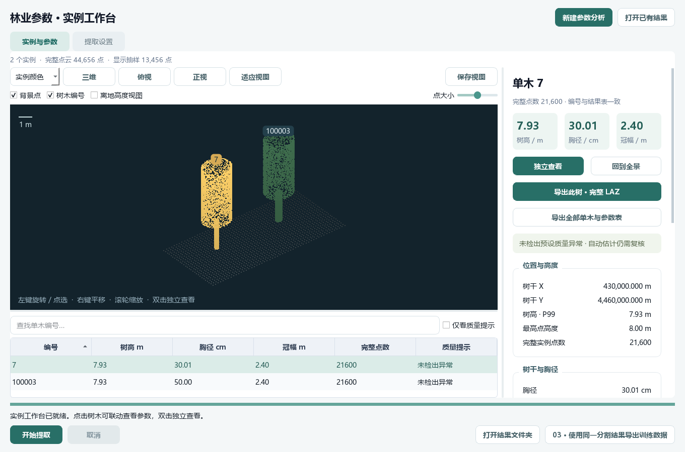

# 林业参数提取

在 **点云处理 → 林业功能 → 02 林业参数提取** 打开独立工具。“单木分割”用于 CSF + TreeIso 分割；本工具负责林业参数统计，也提供以树干为种子的自动分组。

分割完成后可直接点击“02 · 提取林业参数”：自动带入结果目录、CloudCompare 路径和已确认的米制单位，并选择“仅复用已有单木编号”、`instance_id` 和自动地面处理。检查参数后再运行。需要训练数据时，可点击下方“03”按钮继续使用同一分割结果；不会误把参数 CSV 输出当成分割输入。手动更换输入会清除这次交接关系。

上图使用已知尺寸的合成测试点云。

## 实例工作台（v1.7.0）

林业入口位于点云分类第一行，与通用点云工作台并排。在林业页打开“02 林业参数提取”，默认进入实例工作台；“新建参数分析”进入提取设置，“打开已有结果”可重开已完成的参数结果目录。

- 点击点云中的树木或实例表格行，右侧同步显示树高、胸径、冠幅及全部详细参数和质量提示。表格支持数值排序、编号检索和质量提示筛选，取消原先仅展示 200 行的限制。
- 左键拖动旋转，右键或 Shift 拖动平移，滚轮缩放。提供三维、俯视、正视、适应视图、编号开关、背景点开关、点大小与原始 RGB／实例／离地高度着色。
- 双击树木或点击“独立查看”，从完整点云后台加载该实例的细节；“回到全景”恢复样地视图。单木细节最多显示 25 万点，超过时按源序均匀抽样；全景预算约 20 万点，每个参数表实例都有预览点。交互时临时降采样，停止后恢复细节。显示抽样不会影响分析或导出。
- 右侧“导出此树 · 完整 LAZ”或“导出全部单木与参数表”会创建独立目录，生成 `Tree_<原编号>.laz` 和完整参数 CSV。保留源点顺序、坐标量化精度、原属性、CRS、VLR/EVLR；逐文件读回核对点数、编号与完整点记录。取消或失败不会生成完成标志。
- “保存视图”保存当前角度、颜色与编号的 PNG。视图中的离地高度开关只改变显示，不修改源坐标。

新结果包含 `scene_preview.npz`、`scene.json` 和与源点序对应的 `instance_labels.npy`。它们用于快速重开与实例导出，应与结果文件一起保留。关闭整片参数 LAZ 导出时仍能依靠编号索引导出单木，但须保留原始／转换后的完整点云；这种结果的单木细节只有原始坐标视图，没有逐点离地高度时会禁用相应开关。旧版结果只要包含 `参数标注.laz` 和完成记录，也能直接打开，无需重算参数。

本次升级不改变 `forest_metrics.py` 的计算公式与默认参数，也不重新分配已有编号。全景标注最多显示前 120 个编号及当前选中编号，全部实例仍可通过点选和列表访问。高密度遮挡处可切换俯视／正视或用编号检索；这不是人工边界编辑器，点选不会改写分割标签。

## 使用

1. 选择 LAS/LAZ/单点云 BIN，或点击“分割结果目录”选择包含 `forest_instances.laz` 的目录。按文件内容识别格式。
2. 选择输出位置，确认 XYZ 均以米为单位。
3. 默认“自动”优先识别 `instance_id`、`TreeID`、`tree_id` 或 `metric_tree_id`。正整数表示单木，0 表示未分配；非连续编号原样保留。多个编号字段同时存在时需明确填写“编号字段”，不猜测覆盖。也可选择“仅复用已有单木编号”或“从原始点云检测树干”。
4. 默认使用 `semantic_id=1` 的地面点，或 LAS 分类 2；没有地面分类时调用 CloudCompare 的真实 CSF 插件。与“单木分割”共享 CloudCompare 路径。本流程只需 CSF，无需 TreeIso。
5. **只有 Z 已经是离地高度时**才选择“Z 已是离地高度”。文件名 `normalized.laz` 在单木分割结果中表示格式转换，通常仍然是绝对高程，不能据此跳过地面处理。
6. 设置胸径测量高度、切片厚度、半径范围、拟合容差、最少圆弧覆盖及材积形数，点击“开始提取”。完成后在下方查看前 200 行摘要，打开结果文件夹获取完整表格。

已有编号且具有地面分类、或已声明高度归一化的 LAS/LAZ 可以不安装 CloudCompare。BIN 转换及无地面分类的原始点云需要 CloudCompare。仅有树冠、缺少地面或树干的单棵点云无法可靠恢复全部参数，应使用包含地面和全部单木的完整标注点云。

## 输出

每次创建新的 `metrics_日期_随机编号` 文件夹，不覆盖输入。

| 文件 | 内容 |
| --- | --- |
| 林业参数.csv | UTF-8 BOM，全部编号和参数，缺失测量为空 |
| 林业参数.xlsx | 参数表和方法/单位说明，可筛选，冻结编号列 |
| 参数分布.png | 位置分布、有效胸径、树高、冠幅直方图 |
| 参数标注.laz | 可选。保留原始点序、坐标精度、属性、CRS/VLR/EVLR，新增参数编号、离地高度、复核状态 |
| 汇总.json | 所有生效参数、方法、计数、耗时、源文件及输出 SHA-256 |
| result.json | 全部输出读回校验且输入哈希不变后才生成的完成标志 |
| rejected_stems.json | 自动树干模式下未通过质量检查的候选及原因 |

LAZ 新增字段为 `metric_tree_id`、`metric_height`、`metric_review`。若已有同名字段，新增带序号字段并在汇总中记录映射，不覆盖原字段。复核状态 0 为未分配，1 为自动结果，2 为检测到质量问题；1 也不表示人工确认。新增高度单位为米，超过地面支持距离时为 NaN。

## 参数定义和质量检查

| 字段 | 定义 |
| --- | --- |
| TreeID / X / Y | 原单木编号或新树干编号、估计树干位置的原坐标 |
| Height_m / HeightMax_m | 离地高度 P99 / 最大离地高度，单位米 |
| DBH_cm | 默认 1.3 ± 0.12 米高度带内的水平圆截面直径，单位厘米 |
| DBH_fit_inlier / DBH_fit_rmse_m | 最终重算的内点比例 / 径向残差均方根，非置信概率 |
| DBH_arc_deg / DBH_points / DBH_status | 圆弧覆盖角、切片点数、拟合状态 |
| CrownBase_m / ClearBole_m | 几何冠基部估计：连续两个高度层的冠幅达到最大层冠幅的一半 |
| CrownLength_m / CrownRatio | P99 树高减冠基部 / 该长度与树高的比例 |
| CrownEW_m / CrownNS_m | 冠部 X/Y 轴 2%–98% 分位宽度；未验证坐标轴的正东/正北方向 |
| CrownDiameter_m | 上述两个宽度的平均值 |
| CrownArea_m2 | 冠部 XY 凸包面积，不使用角扇区近似 |
| CrownVolume_m3 / CrownSliceCoverage | 高度分层凸包面积积分 / 有效切片比例；少于 80% 覆盖时体积留空 |
| StemVolume_m3 | π × (胸径/2)² × P99 树高 × 用户形数，胸径先换算成米 |
| GroundSupportedFraction / GroundDistanceP95_m | 单木有地面支持的点比例 / 最近地面样点距离 P95 |
| QualityFlags / ReviewRequired | 可读问题代码 / 是否检测到质量问题 |

胸径使用确定性 RANSAC、几何最小二乘精化及重算的内点/误差检查。默认径向容差 0.02 米、内点比例至少 0.5、至少 12 个独立位置、圆弧至少 120°且有多个方向支持。圆弧不足、点数不足或拟合触及半径边界时留空，不用到种子的距离中位数填补。半径范围是用户约束，应根据树种和林龄调整。

自动分组按有效树干的精确二维最近邻分配，默认最长 6 米，超出距离和低于树干下限的点为未分配。该模式依赖树干可见，适用于具备树干信息的点云；树冠交叠、多层林、歪斜树和缺失树干时，应优先复用经过复核的单木编号。通过胸径检查的种子在分组后还会用所属点重新测量，因此最终有效胸径数可能小于候选数。

所有参数均为自动估计。几何冠基部不能证明活枝位置；分层凸包体积是冠包络估计，材积依赖形数，均不能直接替代实测。未提供树种、模型适用范围和系数时不输出生物量。

## 实现与验证

计算使用局部坐标、磁盘映射工作数组、分块读取与导出、稀疏占用格树干检测、KD-tree 邻域检索，以及一次按编号排序后逐组统计。取消或失败会记录状态、清理临时数组，不发布 `result.json`。

回归测试包含已知胸径/树高/冠面积/体积的双树夹具、坡地、大坐标、非连续编号、重复点、噪声、局部圆弧、地面缺失、失败和取消，以及原始字段、CRS 和扩展 VLR 保存。发布构建必须执行实际窗口与后台线程的完整流程，并生成、读回 Excel/PNG/LAZ；有 CloudCompare 时也执行 CSF + 自动树干流程。真实数据验证记录见 `VALIDATION-1.5.0.md`。
