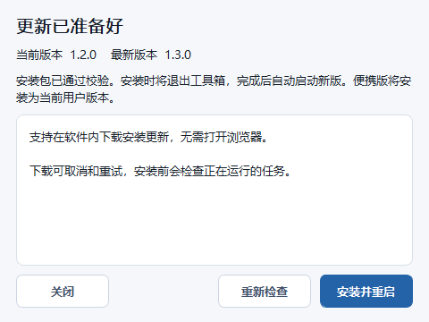

# 在软件内下载安装更新

从 v1.3.0 起，工具箱可以在更新窗口下载、校验并启动安装，无需前往 GitHub 手动下载安装包。

## 使用步骤

1. 点击左下角的检查更新图标。发现新版本时，图标会显示红点。
2. 点击 **下载更新**，查看进度和安装包大小。可以取消，失败后可以重试。
3. 文件通过大小与 SHA-256 校验后，按钮变为 **安装并重启**。
4. 完成正在运行的处理任务并关闭三维窗口，再点击安装。工具箱退出后，安装程序才会更新文件，成功后自动启动新版。

关闭更新窗口后下载仍会继续；关闭整个工具箱会取消下载。下载失败或取消不会改动当前安装。已下载且校验通过的安装包可复用，安装前仍会再次校验。

便携版使用此功能会安装为当前用户版本，原便携目录保留。安装版沿用已经注册的安装位置。安装无需管理员权限，期间显示安装进度，不强制结束其他正在运行的应用实例。

## 首次升级与问题处理

- **v1.2.0 及更早版本**：旧程序没有应用内下载功能，需要先运行一次 v1.3.0 或更新版本的安装包。后续更新直接在软件内完成。
- **检查失败**：检查网络后重新检查。更新失败不会阻止本地工具使用。
- **下载失败或校验失败**：点击重新下载。未完成文件不会被当作可安装的程序。
- **安装按钮提示任务运行中**：完成处理任务、关闭三维窗口后重试；已经下载的文件会保留。
- **无法启动安装**：程序保持打开，可以检查磁盘权限或安全软件后再试。
- **便携版**：安装成功后使用新启动的安装版；原便携文件夹仍然是旧版本，不要继续从旧目录启动。

## 发行维护

软件内更新源：[yaluncoco/RemoteSensingToolbox-Releases](https://github.com/yaluncoco/RemoteSensingToolbox-Releases)，该仓库仅存放发行文件。[原项目仓库](https://github.com/yaluncoco/RemoteSensingToolbox/releases/latest)的每个正式 Release 也必须在 Assets 中提供同一套文件，方便用户直接下载。

1. 更新 `Toolbox/version.py` 的 `APP_VERSION` 和安装器默认版本，完成测试与打包。
2. 在原项目仓库和发行仓库创建同一数字版本的 Release，例如 `v1.3.0`，先作为草稿上传完整资产。
3. 两个仓库的 Assets 均需上传安装包、便携 ZIP、`SHA256SUMS.txt` 和验证报告。安装包必须使用 `RemoteSensingToolbox-1.3.0-windows-x64-setup.exe` 这样的准确名称；原项目 Release 不能只提供外部链接或 GitHub 自动生成的源码压缩包。
4. 确认两个仓库的资产状态为 `uploaded`，大小正确，API 返回 `sha256:...` digest，且均与同一套本地文件一致，再公开发布并设为 Latest。
5. 通过匿名 GitHub API 读取最新版本，验证安装包可下载，并检查原项目 Release 的 Assets 已完整列出可下载文件。

客户端只接受正式发布版本，不安装草稿、预发布或版本号不高于当前版本的更新。下载地址根据固定发行仓库、版本号和资产名称构造，不使用远程返回的任意链接。下载使用 HTTPS，重定向不允许降级到 HTTP。程序不内置 GitHub 访问令牌。

缓存位于系统用户缓存目录下的 `RemoteSensingToolbox/updates`，按 SHA-256 分目录保存。取消的下载会清理临时文件；进程被系统强制结束时，可能留下未完成的 `.part` 文件，它们不会被安装。
