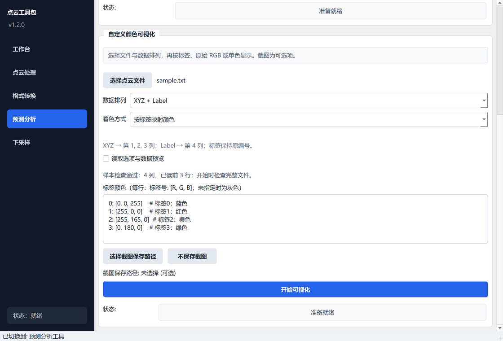

# 点云自定义颜色可视化

入口：**点云处理工作台 → 预测分析 → 自定义颜色可视化**（在标签合并区域下方）。

1. 选择 TXT、XYZ、CSV 或 PTS 数值文本文件。
2. 根据实际列顺序选择“数据排列”，核对下方显示的列号。
3. 选择着色方式。标签模式填写颜色映射，RGB 模式使用文件颜色，XYZ 可使用单色。
4. 查看样本检查结果，需要时展开“读取选项与数据预览”。
5. 点击“开始可视化”。可拖动、缩放三维视图；关闭三维窗口后返回。若选了截图路径，会保存当前视角。

格式区的下拉选项使用点击或键盘选择，列号和表头行数使用输入或增减按钮修改。鼠标滚轮用于滚动页面，不会改变这些参数；刚选中过的控件也一样。



## 数据排列

列号均从 **1** 开始。预设允许末尾有其他数值属性，只读取指定坐标与着色列。程序不根据文件扩展名猜测标签位置。

| 数据排列 | 至少列数 | 列顺序 | 可用着色 |
| --- | ---: | --- | --- |
| XYZ | 3 | X Y Z | 单色 |
| XYZ + Label | 4 | X Y Z Label | 标签、单色 |
| XYZ + RGB | 6 | X Y Z R G B | RGB、单色 |
| XYZ + RGB + Label | 7 | X Y Z R G B Label | 标签、RGB、单色 |
| XYZ + RGB + Label + 法向量 | 10 | X Y Z R G B Label Nx Ny Nz | 标签、RGB、单色 |
| 自定义列位置 | 按设置 | 分别指定坐标与所选着色列 | 标签、RGB、单色 |

默认保留原来的第 7 列标签排列。对于 `X Y Z Intensity Label`，选择“自定义列位置”，坐标设为 1、2、3，标签设为 5。对于 `X Y Z Nx Ny Nz`，不要选择 RGB；可以选择 XYZ 单色并忽略法向量列。

## 四列标签数据示例

```text
0.1 0.2 0.3 1
0.4 0.5 0.6 2
0.7 0.8 0.9 -1
```

选择 **XYZ + Label → 按标签映射颜色**，填写：

```text
1: [255, 0, 0]
2: [0, 180, 0]
-1: [128, 128, 128]
```

可视化会保留标签原编号，包括从 1 开始的标签和负数；不会减 1 或将小数截断为整数。未设置颜色的类别显示灰色，状态栏提示未配色的类别数量。错误或重复的映射行会报错，修改后可重新开始。

颜色可填写 0–1 或 0–255，每个 RGB 三元组使用同一范围。例如 `[255, 1, 0]` 的绿色通道为 `1/255`。RGB 模式的“自动”按整份文件判断范围；若文件采用 0–255 但全部分量恰好只有 0 或 1，请明确选择 **0–255**。

## 分隔符、表头与预览

“读取选项与数据预览”默认折叠，展开后可设置：

- **分隔符**：自动识别空白（空格或 Tab）、逗号、分号，也可手动指定。每份文件使用一致的分隔符。
- **跳过表头**：按文件开头的实际行数跳过，默认 0。CSV 第一行若为 `X,Y,Z,Label`，填 1；PTS 第一行为点数时也填 1。
- **数据预览**：最多读取开头 64 K 字符和 5 行数据，显示前 12 列及列号，避免选文件时加载整个大点云。

文件使用 UTF-8 编码，支持 BOM、空行和 `#` 注释。除跳过的表头外，数据区应为列数一致的数值表，不支持带引号的字符串 CSV。坐标必须有限，标签必须为有限整数，RGB 必须在所选范围内。

“样本检查通过”仅表示前几行符合设置；点击开始后仍会读取并检查完整文件。文件中后部的数据错误也会阻止渲染。样本与完整可视化都不会改写源文件。

## 合并结果与截图

原有“合并预测标签”功能成功后，会自动填入输出文件并选择 **XYZ + RGB + Label**，使用第 7 列标签，同时恢复自动分隔符和 0 行表头。合并功能仍保留原来的标签从 1 开始时减 1 的规则；独立可视化按读取到的编号显示。

截图支持 PNG、JPG/JPEG 和中文路径。点击“不保存截图”可清除已选路径。保存失败会保留原有输出文件；成功时状态栏显示保存位置。三维窗口需要系统支持 OpenGL。
