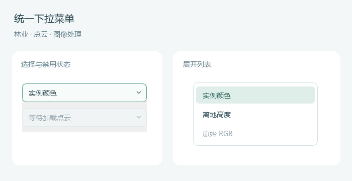

# v1.7.1 下拉菜单统一优化

验证日期：2026-11-28。

## 覆盖范围

检查全部 11 个工具窗口，统一其中的 16 个业务下拉框：

| 工具 | 下拉框数量 |
| --- | ---: |
| 点云处理工作台 | 6 |
| 林业参数提取 | 4 |
| 单木分割 | 2 |
| 训练数据导出 / 转换 | 1 |
| 图像切片 | 1 |
| RGB 颜色提取 | 1 |
| TIF 转 RGB | 1 |

其余四个工具窗口没有业务下拉框。图像与点云的独立启动入口同样加载公共主题。

控件使用圆角边框、矢量线条箭头、柔和的焦点与悬停颜色，展开时切换箭头方向。列表使用圆角条目与轻量滚动条，最多展示十行；按选项文字扩展宽度，并限制在屏幕可用宽度内。

## 验证结果

- **153 项回归测试全部通过，无跳过**，包含真实 CloudCompare 集成。覆盖原有点云处理、林业流程、训练标签、文件读写、任务生命周期和更新下载。
- 源码优化模式与冻结程序各通过 **33 项应用自检**，包括全部窗口、下拉控件资源及交互、真实 CloudCompare 调用和合成点云的完整处理流程。
- 新增发行自检实际渲染三个 SVG 图标，检查禁用项跳过、方向键、Enter 提交一次、Esc 取消、鼠标选择最后一项、长列表滚动及选项数据保留。
- 100%、125%、150%、200% 缩放分别运行下拉交互与截图检查；短列表各行完整显示，弹层处于屏幕范围内。Windows 原生 Qt 平台通过直接控件事件验证；检查过程不操作用户桌面。
- 既有滚轮防误改测试通过：滚动点云/林业参数页不会悄悄修改选项。
- 本机从 v1.7.0 升级到 v1.7.1，**2,503 个安装文件**与构建目录逐文件 SHA-256 相同；安装后的程序通过同样的 **33 项自检**。

## 实现与数据范围

所有业务下拉框使用 `Toolbox.soft_widgets.SoftComboBox`；样式与图标集中在 `Toolbox/dropdown.qss` 和 `Toolbox/icons/`。主题路径以源码或冻结程序资源目录定位，不依赖启动目录。发行构建显式收集主题和图标，并要求下拉控件自检成功。

本版只调整界面、主题加载与发行自检，单木分割、林业参数计算及训练数据格式未改动。真实林地点云的既有验证记录见 [v1.7.0](VALIDATION-1.7.0.md)。本页与工作台截图均使用测试控件或合成点云。
